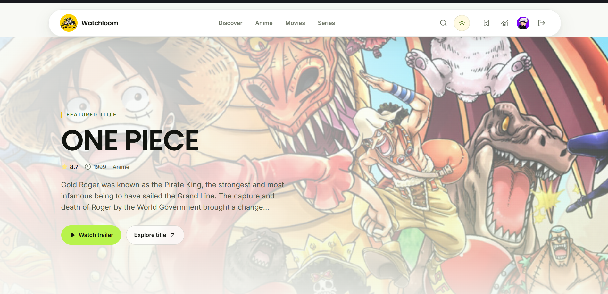
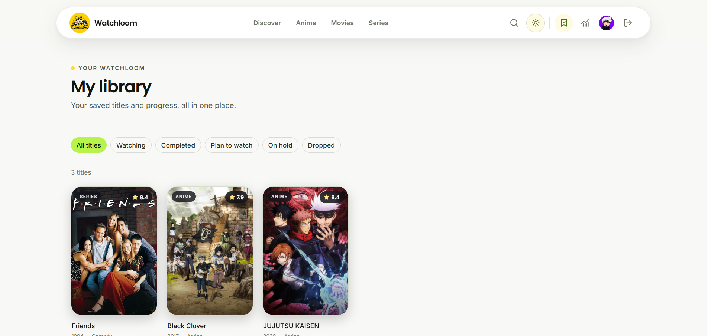
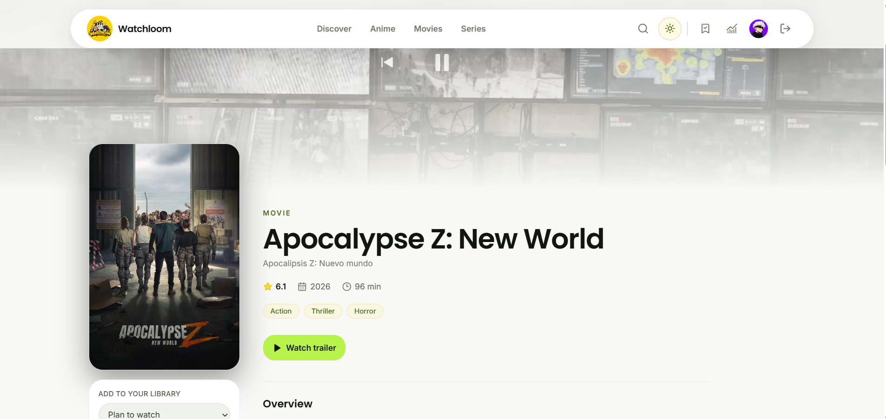

# Watchloom

**A home for every story you watch.**

Watchloom brings movies, TV series, and anime together in one place. Discover something new, save it to your library, and keep track of your progress.

[Open Watchloom](https://watchloom.ankitmohanty.in)

## Screenshots

<p align="center">
  
</p>

<p align="center">
  
  
</p>

## What you can do

- Browse and search movies, series, and anime, including titles from around the world.
- Explore featured titles, popular collections, genres, and recommendations.
- Watch available trailers and open a title page for its overview and details.
- Save titles to a personal library with statuses such as Plan to Watch, Watching, Completed, On Hold, and Dropped.
- Track season and episode progress for series.
- Add personal ratings and notes, and review viewing statistics.
- Customize your profile photo and switch between light and dark themes.
- Share a public comment on the home page after signing in.

## Built with

| Area | Technologies |
| --- | --- |
| Frontend | React 18, TypeScript, Vite, Tailwind CSS |
| Data fetching and state | TanStack Query, Zustand |
| Backend | Python 3.12+, FastAPI, Pydantic |
| Database | MongoDB |
| Media data | TMDB for movies and series; AniList for anime |
| Authentication | JWT tokens and Argon2 password hashing |

## Run locally

### Requirements

- Python 3.12 or newer
- Node.js 18 or newer
- MongoDB, local or hosted
- A TMDB API key for movie and series data

### 1. Configure the backend

In a terminal, from the project root:

```powershell
cd backend
py -m venv .venv
.venv\Scripts\Activate.ps1
pip install -r requirements.txt
Copy-Item .env.example .env
```

On macOS or Linux, activate the environment with `source .venv/bin/activate` and copy the configuration with `cp .env.example .env`.

Edit `backend/.env` and set at least `MONGODB_URI`, `TMDB_API_KEY`, `JWT_SECRET_KEY`, and `REFRESH_TOKEN_SECRET`. Use private, randomly generated values for both token secrets. The example file contains the other local development settings.

Start the API from the `backend` directory:

```bash
python -m uvicorn app.main:app --reload
```

The API runs at `http://localhost:8000`. Interactive API documentation is available at `http://localhost:8000/docs`.

### 2. Configure the frontend

Open a second terminal from the project root:

```powershell
cd frontend
npm install
Copy-Item .env.example .env
npm run dev
```

On macOS or Linux, use `cp .env.example .env` in place of `Copy-Item`. The default `VITE_API_BASE_URL` points to the local backend at `http://localhost:8000`.

Open `http://localhost:5173` in your browser.

### Optional email delivery

Password-change verification codes need a configured email provider. The backend example is set up for Resend SMTP. Set `SMTP_PASSWORD` to your Resend API key and use a sender address on a domain verified with Resend. If using the shared Resend template, set `RESEND_API_KEY` and `RESEND_OTP_TEMPLATE_ID` as required by your deployment configuration. Keep provider credentials in backend environment variables; never put them in the frontend or commit them to the repository.

## Docker

Create `backend/.env` from `backend/.env.example` and configure the required values, then run from the project root:

```bash
docker compose up --build
```

The application is available at `http://localhost:5173`, and the API at `http://localhost:8000`. Stop the services with `Ctrl+C`, or run `docker compose down` in another terminal.

## Useful commands

### Frontend

Run these commands from `frontend/`:

```bash
npm run dev          # Start the development server
npm run type-check   # Check TypeScript types
npm run lint         # Run ESLint
npm run build        # Create a production build
npm run preview      # Preview the production build
```

### Backend

Run these commands from `backend/` with the virtual environment activated:

```bash
pytest               # Run backend tests
ruff check .         # Lint Python code
ruff format .        # Format Python code
```

## Project layout

```text
backend/
  app/
    api/              API routes
    core/             Configuration and security
    db/               MongoDB connection
    integrations/     TMDB and AniList clients
    models/           Database models
    repositories/     Data access
    schemas/          API request and response schemas
    services/         Application logic
  tests/
frontend/
  src/
    components/       Shared interface components
    pages/            Application pages
    services/         API clients
    store/            Client state
    types/            TypeScript types
screenshot/           Product screenshots used in this README
```

## License

This project is available under the [MIT License](LICENSE).
